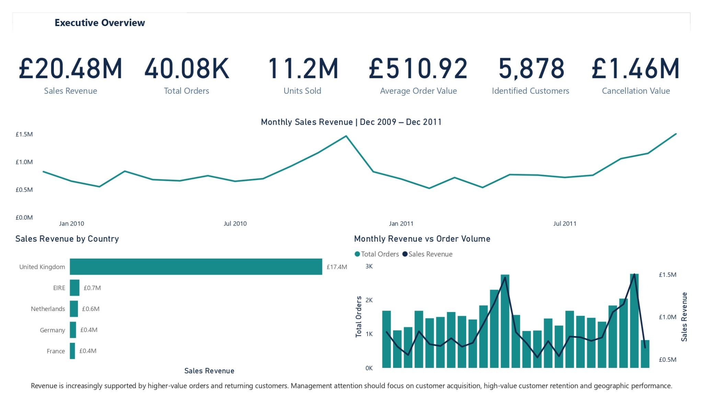
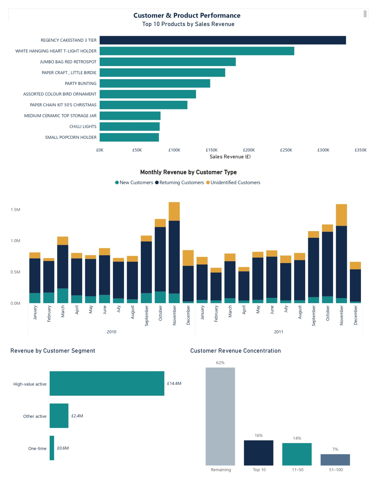
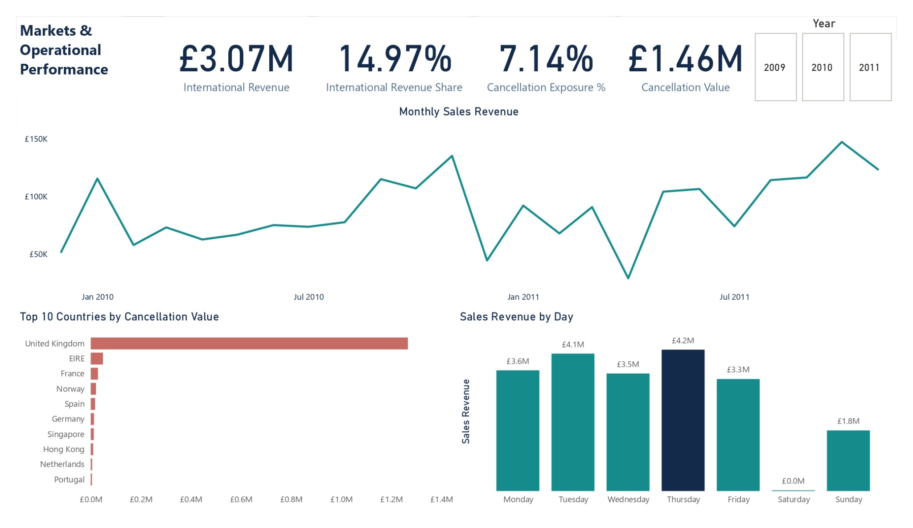

# Retail Commercial Intelligence

**A commercial analytics portfolio project using Python, SQLite, SQL and Power BI.**

The project investigates whether reported retail revenue is supported by durable customer behaviour, diversified products and markets, and manageable operational exposure.

## Explore the dashboard

The report has three pages. The screenshots below are available directly in this repository.

### 1. Executive Overview



### 2. Customer & Product Performance



### 3. Markets & Operational Performance



## Open or download the report

- **[View the Power BI report](https://app.powerbi.com/groups/me/reports/a83615fd-347e-43cf-8a66-79ac70156f6d/61b6bb91056861a56a87?experience=power-bi)** — access depends on Power BI sharing permissions; viewers may need to sign in.
- **[View the PDF report](Retail_Commercial_Intelligence.pdf)** — easiest way to inspect all three pages without Power BI.
- **[Download the editable Power BI file](Retail_Commercial_Intelligence.pbix)** — requires Power BI Desktop.

## Business question

Is the retailer generating durable revenue, or is reported performance vulnerable to customer concentration, weak repeat purchasing, product dependence and cancellations?

## Key findings

- **£20.48m sales revenue** across **40,077 orders**, with an average order value of **£510.92**.
- November 2011 new-customer revenue was **53.3% lower year on year**, while returning-customer revenue was **6.0% higher**.
- The project's rule-based segmentation identified **449 high-value inactive customers** with at least five orders, at least £1,000 historical revenue and no purchase for at least 91 days. Their historic revenue was approximately **£1.76m**; this is not a forecast of recoverable revenue.
- The top 100 identifiable customers account for **37.55% of identifiable-customer revenue**.
- The UK accounts for **85.51% of merchandise revenue**. International growth is uneven and, in some markets, highly concentrated among a small number of customers.
- Cancellation value is approximately **£1.46m**, but includes unusual bulk and non-merchandise adjustments. It should not be read as a confirmed lost-sales rate.

## Project workflow

1. **Python:** data preparation, duplicate auditing, description recovery and transaction classification.
2. **SQLite:** dimensional modelling with a transaction-line fact table and five dimensions.
3. **SQL:** commercial analysis of revenue, customer behaviour, product and order concentration, geography and cancellations.
4. **Power BI:** interactive three-page management report.

## Technology

- Python: pandas, NumPy, openpyxl
- Database: SQLite
- SQL: data modelling, validation, joins and aggregations
- Visualisation: Microsoft Power BI

## Repository structure

```text
.
├── dashboard/                 # Dashboard asset notes
├── docs/                      # Data dictionary and commercial findings
├── powerbi/                   # Power BI model and reporting guidance
├── scripts/                   # Python cleaning pipeline
├── sql/                       # SQLite schema, population and validation
├── Retail_Commercial_Intelligence.pdf
├── Retail_Commercial_Intelligence.pbix
├── executive-overview.png
├── customer-product-performance.png
├── markets-operational-performance.png
└── requirements.txt
```

## Data and limitations

The project uses the **Online Retail II** dataset from the UCI Machine Learning Repository ([dataset source](https://archive.ics.uci.edu/dataset/502/online+retail+ii)), provided under **CC BY 4.0**.

- December 2011 is partial and ends on 9 December.
- Transactions without a customer ID remain in total sales but are excluded from identified-customer metrics.
- Customer segments use project-defined thresholds, not industry standards.
- Product cost data is unavailable; this project analyses revenue, not profit or gross margin.
- The data does not include marketing spend, acquisition channels, inventory availability or cancellation reasons. Causal conclusions and investment-return claims are outside scope.

## Author

Talha Hassan Saleem
